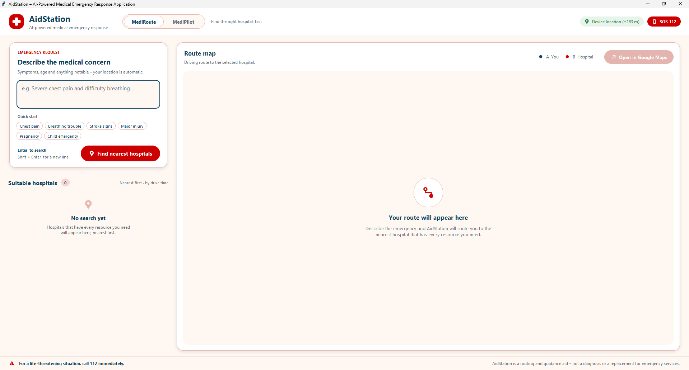
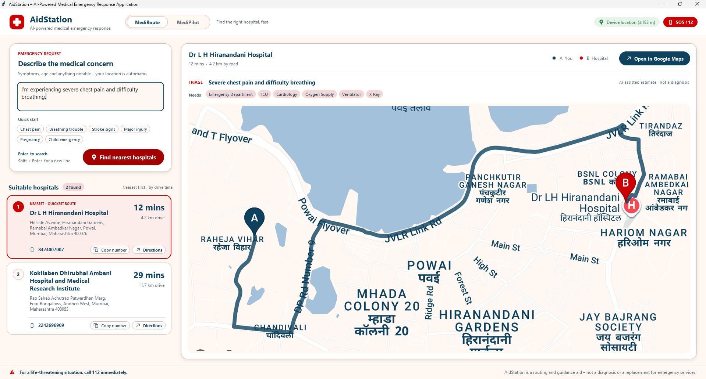
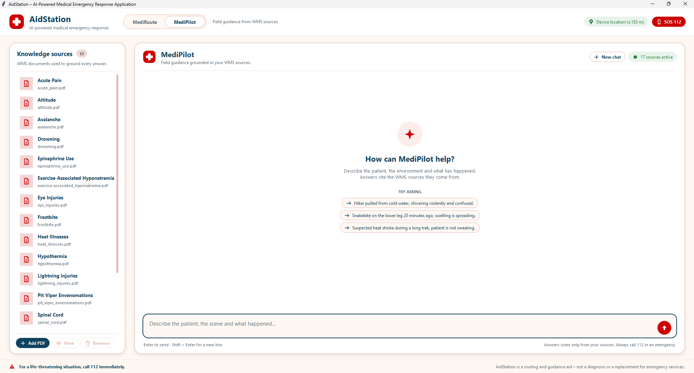
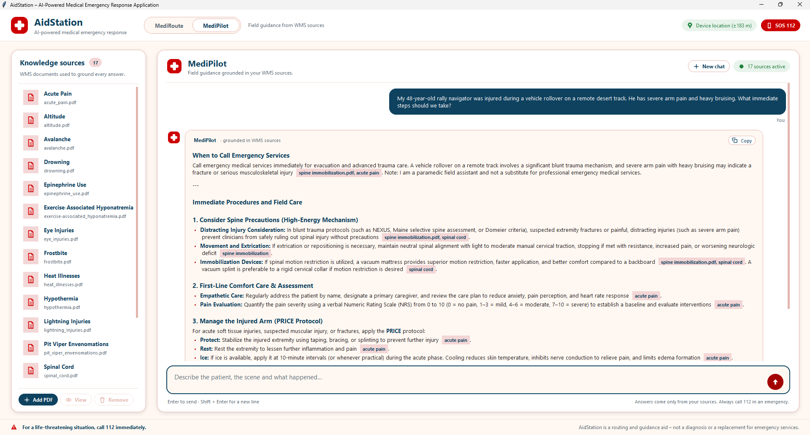
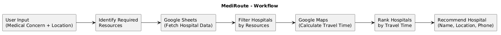
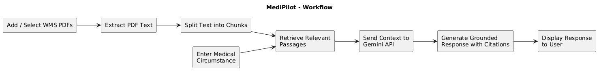

<div align="center">

# 🏥 AidStation

### AI-powered medical emergency response

AidStation contains two coordinated emergency-response modules:

- **MediRoute** identifies the closest hospital with the emergency resources
  required for a described concern and provides a route.
- **MediPilot** is a retrieval-augmented paramedic assistant. It grounds
  practical, procedural answers in selected Wilderness Medical Society (WMS)
  documents. The supplied WMS documents are enabled by default; sources can be
  viewed, added, or removed from the left-hand source panel.

<br>


</div>

## 🖥️ Screenshots

### MediRoute

<p align="center">
  
</p>

<p align="center">
  
</p>

### MediPilot

<p align="center">
  
</p>

<p align="center">
  
</p>

## 🔁 Agent workflows

### MediRoute workflow

<p align="center">
  
</p>

| Stage | Responsibility |
|---|---|
| **1. User input** | Receive medical concern and current location |
| **2. Resource analysis** | Gemini identifies the concern and required services |
| **3. Hospital data** | Fetch resource availability from Google Sheets |
| **4. Resource filtering** | Keep hospitals that satisfy every required resource |
| **5. Route calculation** | Google Routes API estimates driving distance and time |
| **6. Recommendation** | Return the quickest suitable hospital and alternatives |

### MediPilot workflow

<p align="center">
  
</p>

## 🧩 Architecture

```text
Tkinter UI
    │
    ▼
LangGraph stateful workflow
    ├── Gemini ─────────────── concern, location, resource requirements
    ├── Google Sheets ──────── hospital details and resource availability
    └── Google Routes API ──── driving distance and travel time
```

### Project structure

```text
ERoute/
├── main.py              # Application entry point
├── ui.py                # Chat-style Tkinter interface
├── agent.py             # LangGraph workflow and Gemini orchestration
├── sheets_service.py    # Google Sheets CSV loading and resource matching
├── maps_service.py      # Google Routes API and static map helpers
├── config.py            # Environment-backed configuration
├── requirements.txt     # Python dependencies
├── .env.example         # Safe environment-variable template
└── assets/              # Screenshots and workflow diagram
```

## 🚀 Quick start

### 1. Create and activate a virtual environment

PowerShell on Windows:

```powershell
cd D:\Projects\Python\ERoute
py -m venv .venv
.\.venv\Scripts\Activate.ps1
```

If PowerShell blocks activation:

```powershell
Set-ExecutionPolicy -Scope CurrentUser RemoteSigned
```

### 2. Install dependencies

```powershell
python -m pip install --upgrade pip
python -m pip install -r requirements.txt
```

### 3. Configure API keys

Create a `.env` file in the project root:

```env
GEMINI_API_KEY=your-gemini-api-key
GOOGLE_MAPS_API_KEY=your-google-maps-api-key
GEMINI_MODEL=gemini-3.8-flash
```

Required Google Cloud APIs:

- **Routes API** — travel-time ranking and directions
- **Maps Static API** — map preview cards

The hospital workbook is configured in `config.py` and is read through its
public CSV export.

### 4. Run AidStation

```powershell
python main.py
```

Enter a prompt such as:

```text
I have severe chest pain and difficulty breathing. I'm near Andheri West,
Mumbai. Find the nearest hospital with the required services.
```

Press **Enter** to submit. Use **Shift+Enter** for a new line.

## 🔐 Security and configuration

- API keys are loaded from environment variables with `python-dotenv`.
- `.env` must never be committed or shared.
- Restrict Google API keys by application, API, and billing project where
  possible.
- Do not place secrets in `config.py`, screenshots, logs, or source control.
- The Google Sheets workbook contains hospital resource data and must remain
  accessible to the application.

## 🏥 Supported resource signals

The current resource catalog includes:

`Emergency Department` · `ICU` · `Ventilator` · `CT Scanner` · `MRI Scanner` ·
`X-Ray` · `Blood Bank` · `Emergency Surgery` · `Cardiology` · `Neurology` ·
`Dialysis` · `Oxygen Supply` · `Pediatric Emergency` · `Obstetrics`

Resource matching is intentionally strict: a hospital is a candidate only if
every resource selected for the concern is currently marked available.

## ⚠️ Limitations

- Results depend on the accuracy and freshness of the hospital workbook.
- Travel times depend on Google routing data and current traffic conditions.
- Gemini's resource selection is an AI-assisted triage estimate, not a
  diagnosis.
- API quotas, billing, network failures, or unavailable routes can prevent a
  recommendation.
- The current application is designed for local desktop use with Tkinter.
